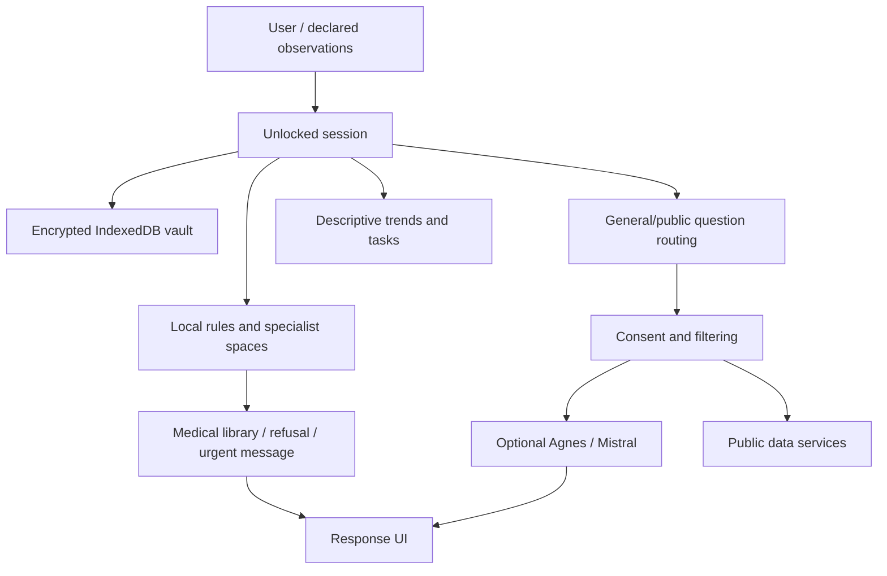

# FibroBot V32 — Studio Niko Design

**A privacy-oriented, single-user daily-life companion with an encrypted local vault and bounded medical information.**

Un compagnon expérimental d'organisation et d'information autour de la fibromyalgie, avec coffre local chiffré et séparation entre dossier privé, règles documentaires et fournisseurs externes.

   

**STUDIO NIKO DESIGN** · Build smart. Stay lightweight. Create without limits.

[Démo existante (disponibilité non vérifiée)](https://nikoju1977.github.io/fibrobot/) · [English overview](#english-overview) · [Quickstart](#quickstart--démarrage-rapide)

> Démonstration et qualification : données fictives uniquement. Aucun GIF ni résultat de test n'est revendiqué.

> **Prototype non validé cliniquement.** Ne pas utiliser pour une décision médicale, un diagnostic, une prescription ou une urgence. En France, danger immédiat : 15 ou 112. Inspection statique de sources uniquement ; aucun nouveau test, audit de sécurité, appel réel fournisseur, essai sur appareil ou validation clinique n'a été réalisé pour ce README.

## Pourquoi ce projet ?

Préserver le contrôle de l'utilisateur sur ses observations, sa charge quotidienne et les données transmises. Les réponses médicales documentaires, règles de sécurité et fonctions de planification sont distinctes des modèles distants. La conception locale ne constitue pas une certification de sécurité ou d'efficacité médicale.

## Fonctionnalités clés

- 🔐 Coffre IndexedDB AES-256-GCM, dérivation PBKDF2-SHA-256, verrouillage et export chiffré.
- 📓 Journal des symptômes, énergie, sommeil, tâches, rendez-vous et médicaments déclarés ; recherche privée et tendances descriptives.
- 📚 Bibliothèque médicale sourcée, huit espaces thématiques et réponses locales avec refus de prescription et détection heuristique d'urgences.
- 🧠 Agnes AI principal selon la documentation V32 ; passerelle Mistral également présente, routage et contrôle des requêtes.
- 🌐 Services publics (météo, air, calendrier, recherche documentaire), consentement et budget d'appels.
- 🔔 Rappels au premier plan, exports calendrier, respiration guidée, lecture et voix selon navigateur.

## Architecture & algorithmes

| Fichier inspecté | Responsabilité |
| --- | --- |
| [core.mjs](core.mjs) | Validation des observations, tâches adaptées à l'énergie, recherche de preuves et refus/urgences par règles. |
| [agent-hub.mjs](agent-hub.mjs) | Routage documentaire et huit espaces thématiques, non huit professionnels ni agents LLM indépendants. |
| [health-trends.mjs](health-trends.mjs) | Agrégation descriptive des observations ; pas d'inférence diagnostique. |
| [vault.mjs](vault.mjs) / [vault-ui.mjs](vault-ui.mjs) | Dérivation, chiffrement, authentification de l'enveloppe, contrôle de concurrence et export. |
| [agnes-bridge.mjs](agnes-bridge.mjs) | Appels réseau, annulation et gestion des limites d'accès. |
| [app.mjs](app.mjs) | Orchestration des parcours, garde de session, consentement et routage. |

**Risques cliniques :** la détection d'urgence repose sur des motifs et ne couvre pas tous les scénarios ; les refus peuvent échouer devant une formulation imprévue. La bibliothèque doit faire l'objet d'une revue médicale continue. Les médicaments sont déclarés, sans contrôle des interactions ni prescription. Les tendances ne démontrent pas de causalité. Les rappels ne sont pas garantis lorsque la PWA est fermée ; ne jamais les utiliser comme dispositif d'alerte critique.

## Confidentialité et sécurité

- `vault.mjs` utilise AES-GCM 256 bits, un sel aléatoire de 16 octets, un IV aléatoire de 12 octets et PBKDF2-SHA-256 à 600 000 itérations par défaut. La phrase secrète impose au moins 12 caractères ; la clé n'est pas persistée. Le contrôle transactionnel du ciphertext vise à éviter les écrasements concurrents.
- Une sauvegarde chiffrée n'empêche pas la perte de phrase secrète, la purge du navigateur ou l'accès via appareil compromis. Les données déchiffrées sont présentes pendant la session. Les impressions et exports en clair restent sensibles ; la base historique peut subsister si la migration/suppression est refusée ou bloquée.
- Les parcours inspectés appliquent des règles de routage et consentement avant les requêtes externes. Les filtres heuristiques ne constituent pas une garantie absolue de non-divulgation ; vérifier chaque requête et les données éventuellement incluses. Les clés Agnes/Mistral peuvent être stockées dans le coffre selon les modules disponibles et sont utilisées en mémoire en session.
- Les appels Agnes, Mistral et sources publiques nécessitent réseau, conditions fournisseur et vérification des flux. Les fonctions vocales et les ressources tierces nécessitent un audit distinct. Aucun audit de sécurité indépendant n'est revendiqué.

[V32](V32.md) décrit la version active ; [VALIDATION.md](VALIDATION.md) contient aussi des étapes historiques (notamment Gemma), qui ne prouvent pas leur disponibilité dans le parcours V32 actuel. Voir [SECURITY.md](SECURITY.md) pour les signalements confidentiels.

## Cadre médical et réglementaire

Les références à la qualité des dispositifs médicaux (ISO 13485), au cycle de vie logiciel (IEC 62304), à la gestion des risques (ISO 14971) ou à la protection des données (RGPD) sont des pistes de qualification selon l'usage prévu, et non des déclarations de conformité. L'applicabilité réglementaire doit être évaluée par des spécialistes. Aucune validation clinique, certification, autorisation de mise sur le marché ni conformité à FDA 21 CFR Part 11 n'est démontrée.

## Quickstart / Démarrage rapide

Servir la racine par `python3 -m http.server 8000` et ouvrir http://localhost:8000/ ; le coffre nécessite Web Crypto et un contexte sécurisé. Créer un coffre de test avec une phrase secrète de test, ajouter une observation fictive puis vérifier export, verrouillage et restauration. Laisser les fournisseurs externes désactivés pendant les premiers essais.

Contrôles documentés : `node --check app.mjs` et `node --test tests/*.test.mjs`. Voir [V32.md](V32.md) et [VALIDATION.md](VALIDATION.md) pour les parcours navigateur et leur portée. Aucun nouveau test n'a été exécuté ici.

## Qualification proposée — coffre, routage et limites médicales

**Usage prévu de cette démonstration :** organisation quotidienne, journal descriptif et information générale. Les espaces spécialisés ne sont ni des professionnels de santé ni une preuve d'expertise clinique. La présence de contrôles cryptographiques et de règles de routage ne constitue pas un audit indépendant.

| Contrôle proposé (non exécuté) | Critère attendu |
| --- | --- |
| Coffre | Créer des données fictives, verrouiller, rouvrir, vérifier leur restitution |
| Sauvegarde | Exporter une enveloppe chiffrée, restaurer dans un contexte de test et vérifier son intégrité |
| Erreurs de session | Refuser une phrase secrète incorrecte ou une enveloppe altérée, sans perte silencieuse |
| Frontières de données | Vérifier qu'une recherche privée reste locale et que les requêtes externes exigent l'autorisation prévue |
| Routage médical | Vérifier les refus de prescription et les messages d'orientation sur scénarios fictifs, y compris formulations atypiques |
| Rappels | Distinguer les rappels au premier plan des notifications système ; ne jamais leur confier une alerte critique |

Conserver les observations de test, la version du navigateur, le commit et les preuves réseau sans données réelles. Le coffre protège le stockage fermé, pas une session déverrouillée ou un appareil compromis. Les résultats antérieurs de [VALIDATION.md](VALIDATION.md) et [V32.md](V32.md) restent historiques ; aucun nouveau test ou appel fournisseur n'a été lancé ici.

**English:** Proposed checks cover encrypted vault integrity, recovery, session lock, consent, data boundaries and medical refusal behavior. Passing these checks would not establish clinical effectiveness or absolute confidentiality. No new tests were performed.

## Roadmap & contribution

Propositions non terminées :

- [ ] Faire relire les fiches et scénarios de sécurité clinique, notamment formulations atypiques et urgences.
- [ ] Tester les frontières de confidentialité et les refus sur des entrées synthétiques adversariales, avec inspection du réseau.
- [ ] Auditer le coffre, le verrouillage, les migrations, les sauvegardes et les dépendances.
- [ ] Vérifier les appareils réels iOS/Android, le hors-ligne, les rappels et les API avec comptes de test autorisés.

**Première contribution / `good first issue` (label proposé, non créé ici) :** Proposer un test unitaire de refus de prescription ou une régression de verrouillage sur données fictives. Pour une vulnérabilité, suivre [SECURITY.md](SECURITY.md), pas les issues publiques.

Les retours reproductibles sont bienvenus ; les modifications et redistributions restent soumises à la notice de droits existante. [Issues](https://github.com/Nikoju1977/fibrobot/issues) pour les sujets non sensibles. Ne jamais publier de données de santé, de captures personnelles, de clés API ou de détails exploitables de vulnérabilité. Contacter le mainteneur en privé pour les problèmes de sécurité.

## English overview

FibroBot V32 is an experimental single-user companion with an AES-256-GCM encrypted IndexedDB vault, PBKDF2-SHA-256, descriptive health trends, a local medical library and deterministic specialist spaces. Optional Agnes/Mistral calls and public data services have routing and consent controls; these are not proof of perfect filtering or privacy. The vault protects data at rest, not an unlocked or compromised session. Medical rules and reminders are not clinically validated or suitable for critical decisions. Historical validation documents include earlier model experiments; consult V32 for current scope.

No new runtime, security or clinical validation was performed in this documentation revision.

## Licence & auteur / License & author

[Notice de droits d'auteur](LICENSE.md) © 2026 Studio Niko Design (Nikoju1977). Tous droits réservés pour les contributions originales concernées ; publication publique ≠ licence open source. Les composants tiers conservent leurs droits. Aucun fichier de licence n'a été modifié.

[Studio Niko Design — Portfolio](https://github.com/Nikoju1977)
